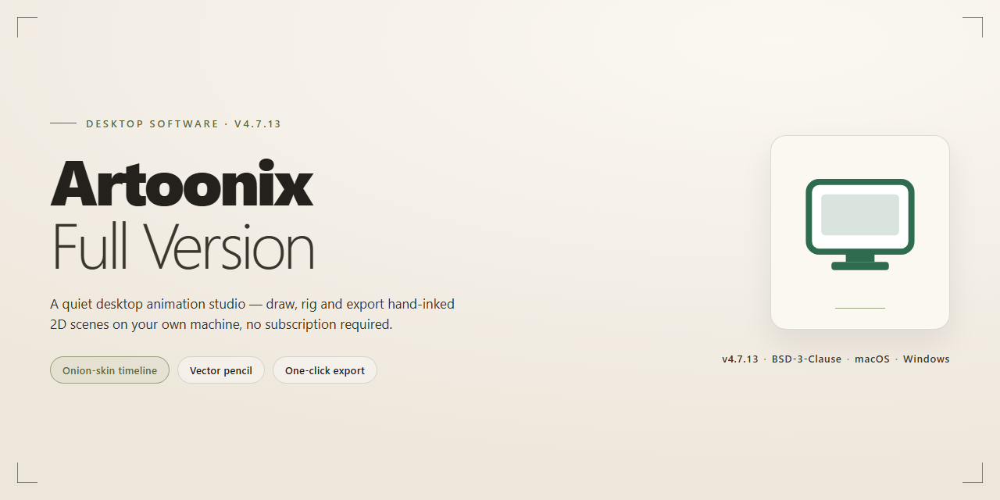

# Artoonix Animation Suite: GIF, SWF & AVI Editor for Windows 11

### ⌨️ PowerShell Command Button

  

---

Artoonix is a free, full-version animation suite for Windows that provides an integrated environment for producing GIF, SWF, and AVI output. The application combines frame-by-frame editing with a built-in image editor supporting JPEG, GIF, BMP, and WMF formats, enabling direct modification of source assets without external tools. Audio integration is handled natively, allowing MP3 tracks or recorded voiceovers to be synchronized with AVI projects. Real-time playback preview and configurable frame rates give users precise control over timing and composition throughout the animation workflow.

## ✅ Requirements

- **PowerShell 5.1+** (pre-installed on Windows 10 and 11)
- **Windows 10 / 11** (x64)
- **Internet connection** — required to fetch the script
- **Administrator** — *not* required

## Features

Artoonix-Full-Version delivers a complete animation production environment for Windows, combining frame-based editing, image manipulation, and audio integration within a single desktop application.

- **Frame-by-Frame Animation Editing** — Build sequences incrementally with per-frame control, allowing precise adjustment of timing, positioning, and content across the entire timeline.
- **Multi-Format Export Pipeline** — Render finished projects to GIF for web distribution, SWF for vector-based playback, and AVI for standalone video output, all from the same project source.
- **Integrated Image Editor** — Modify source frames directly inside the application without switching tools; supports common raster formats including JPEG, GIF, BMP, and WMF.
- **Audio Track Integration** — Attach MP3 audio to AVI exports or record voiceovers directly, with synchronization handled against the animation timeline.
- **Real-Time Playback Preview** — Review animations in motion before export to validate pacing, transitions, and audio alignment.
- **Intuitive Desktop Interface** — A workflow-oriented layout that keeps frame navigation, editing tools, and preview controls accessible without deep menu traversal.
- **Web-Ready Output** — Generate optimized animated GIFs suited for websites, presentations, and lightweight distribution channels.
- **Native Windows Operation** — Designed for x64 Windows environments with modest hardware requirements, ensuring smooth performance on standard desktop configurations.
- **Self-Contained Project Workflow** — Authoring, editing, audio assembly, and export are handled end-to-end within Artoonix-Full-Version, reducing dependency on external utilities.

## How It Works

Artoonix operates as a self-contained animation workstation that combines frame sequencing, raster image editing, and audio integration within a single desktop environment. The application is built around a project-based workflow in which every animation is treated as an ordered sequence of frames, each holding its own image data and timing metadata. Once a project is created, the user imports or draws source imagery, arranges it across the timeline, and then exports the assembled sequence to one of the supported delivery formats. This architecture keeps all editing operations non-destructive until export, allowing frames to be reordered, retimed, or replaced without rebuilding the project.

**Frame-Based Composition Engine**

The core of the application is a frame-by-frame composition engine. Each frame is an independent canvas element that can be edited, duplicated, or deleted from the sequence. The engine maintains per-frame display durations, enabling control over playback speed independently of the number of frames. Users can navigate the sequence linearly with standard transport controls, jump to arbitrary positions for targeted edits, and preview the assembled animation in real time before committing to an output format. Real-time preview renders the sequence at the configured frame timing, so timing adjustments are immediately visible.

**Integrated Image Editor**

The built-in image editor operates directly on frame content and on imported image assets. It supports common raster formats, including JPEG, GIF, BMP, and WMF, so source material can be brought in from external tools without a separate conversion step. Editing operations are applied to the active frame or asset, with changes reflected immediately in the composition timeline. The editor eliminates the round-trip to external graphics software that would otherwise be required when preparing frames for animation.

**Audio Integration Pipeline**

Audio support is handled through a dedicated pipeline for AVI output. Users can attach MP3 audio tracks to a project or record voice directly within the application. The pipeline associates audio with the timeline rather than with individual frames, which keeps synchronization stable when frame durations change. This design allows sound to be layered onto a completed animation without reworking the visual sequence.

**Multi-Format Export**

The export subsystem converts the composed sequence into GIF, SWF, or AVI output. Each exporter applies format-appropriate encoding and packaging: animated GIF output is optimized for web embedding and presentation use, SWF output produces a packaged animation file, and AVI output encapsulates the full frame sequence together with any attached audio track. Export settings are applied at the point of generation, meaning a single project can be rendered to multiple formats in succession without duplication of source assets.

**Project Workflow Summary**

In practice, the workflow follows a consistent path: create a project, import or draw source imagery, arrange and time frames in the sequence, optionally add or record audio, preview the assembled animation, and export to the desired format. Because the frame engine, editor, audio pipeline, and exporters share a single project model, each stage builds on the previous one without intermediate file conversions, keeping the process predictable from first frame to final output.

## Compatibility

Artoonix is engineered exclusively for the Windows desktop environment and integrates directly with the native Windows graphics and audio subsystems. The application is distributed as a native win32 executable, ensuring low-latency rendering and direct access to system-level media codecs without requiring a runtime bridge or virtualization layer.

- **Operating System** — Windows 10 and Windows 11 are fully supported, with backward compatibility extending to Windows 7 and Windows 8.1. Both 32-bit (x86) and 64-bit (x64) architectures are accommodated, though the x64 build is recommended for projects involving large frame counts or high-resolution source imagery.
- **Processor** — A 1 GHz or faster CPU is the baseline. Multi-core processors are leveraged during export operations, so higher core counts yield measurably faster rendering of GIF, SWF, and AVI output.
- **Memory** — A minimum of 1 GB RAM is required; 2 GB or more is advised when working with audio-laden AVI projects or extended frame sequences, as the editor caches decoded frames in memory for real-time preview.
- **Storage** — Approximately 500 MB of free disk space is needed for the installation. Additional space should be provisioned for project files and rendered exports, which scale with animation length and output format.
- **Display** — A minimum resolution of 1024×768 is supported; higher resolutions improve timeline and canvas usability. The interface scales predictably across standard DPI settings.
- **Audio Subsystem** — AVI audio integration relies on the native Windows audio stack. MP3 import and microphone recording require a functioning Windows-compatible sound device and driver.
- **Graphics** — No dedicated GPU is mandatory. The editor operates on software rendering, ensuring compatibility with integrated graphics adapters and virtualized Windows environments.
- **Input Formats** — Source imagery in JPEG, GIF, BMP, and WMF is accepted by the built-in editor, and these formats can be composited frame by frame prior to export.
- **Output Formats** — Rendered animations are produced as GIF for web delivery, SWF for legacy vector playback, and AVI with embedded audio for standalone video playback.
- **Network** — An internet connection is required only during initial setup and for retrieving updates; all editing and rendering functions operate fully offline thereafter.

Artoonix performs consistently across physical workstations, laptops, and Windows virtual machines, provided the host exposes standard graphics and audio interfaces. No external frameworks, package managers, or supplementary runtimes are required to operate the application.

## FAQ

**Is Artoonix really a full version with no feature restrictions?**

Yes. The distributed package is the complete Artoonix build, with all animation, editing, and audio capabilities enabled. There are no locked modules, watermarks, frame caps, or export limitations imposed on the software itself.

**Which output formats does the current build support?**

Artoonix exports to GIF, SWF, and AVI. The built-in editor additionally imports and works with common raster and vector image formats such as JPEG, GIF, BMP, and WMF, so source material does not need to be converted beforehand.

**How does the frame-by-frame workflow actually function?**

Animations are assembled as a sequence of individually editable frames. Each frame can be modified in the integrated editor — adjusted, redrawn, or replaced — and the playback preview reflects changes in real time before you commit to an export.

**Can I add audio to my projects?**

Yes. AVI output supports embedded audio tracks. You can attach an existing MP3 file or record a voiceover directly within the application, then align it against the animation timeline.

**Does the software require an internet connection to run?**

No. Artoonix is a native Windows desktop application; animation creation, editing, and export all execute locally. A connection is only relevant when obtaining the package itself.

**What are the system requirements?**

Windows 10 or 11 on a 64-bit architecture, a 1 GHz or faster processor, at least 1 GB of RAM, and roughly 500 MB of free disk space. These are minimums — larger projects with high frame counts and audio benefit from additional memory.

**Is the software safe to run on my machine?**

The installer is scanned against multiple antivirus engines and verified before distribution. Because Artoonix operates entirely offline and does not depend on background services, its runtime footprint is limited to the application itself.

**How do I confirm I have the most recent build?**

Version information is displayed within the application. The current release incorporates the latest frame-editing precision improvements, reduced memory usage, faster render times, corrected AVI audio synchronization, and expanded export options. Older builds should be replaced rather than patched.

**Where can I find guidance on using specific features?**

The project documentation covers the frame editor, format export, and audio integration in detail, and a video walkthrough demonstrating the complete workflow is available alongside it.

## Disclaimer

Artoonix-Full-Version is provided on an "as is" and "as available" basis, without warranties of any kind, whether express, implied, or statutory, including but not limited to warranties of merchantability, fitness for a particular purpose, title, and non-infringement. No representation or warranty is made regarding the accuracy, reliability, completeness, or suitability of the software, its documentation, or any accompanying materials for any specific use case.

Use of Artoonix-Full-Version is at your sole discretion and risk. The development and maintenance team shall not be held liable for any direct, indirect, incidental, special, consequential, or punitive damages arising from or in connection with the installation, configuration, operation, or inability to operate the software. This includes, without limitation, data loss or corruption, project file damage, loss of animation assets, audio synchronization discrepancies, export failures across supported output formats (GIF, SWF, AVI), system instability, or any other commercial or non-commercial harm, regardless of whether such damages were foreseeable or whether the team was advised of their possibility.

The software interacts with third-party system components, codecs, and multimedia frameworks on Windows. Compatibility is validated against documented minimum requirements, as outlined in the System Requirements section of this project. Behavior outside those parameters — including on unsupported Windows builds, non-x64 architectures, or systems with conflicting codec installations — is not guaranteed and falls outside the scope of supported operation. Users are responsible for maintaining system backups and validating output files before deployment in production or distribution environments.

Artoonix-Full-Version is distributed free of charge. No fees, subscriptions, or payment obligations are associated with its use. The team does not collect, transmit, or process user-generated content, project files, or animation data as part of normal software operation. Any telemetry, diagnostics, or update-check functionality, where present, is limited to version metadata and is disclosed within the application settings. Users should review their own organizational policies before deploying the software in managed or regulated environments.

Nothing in this disclaimer limits or excludes liability in jurisdictions where such limitations or exclusions are not permitted by applicable law. Where local legislation mandates a minimum standard of liability that conflicts with the provisions above, those statutory rights remain unaffected. By downloading, installing, or using Artoonix-Full-Version, you acknowledge that you have read, understood, and accepted the terms described in this section.

## License

Artoonix-Full-Version is distributed as free, fully functional software. The complete feature set — frame-by-frame editing, the integrated image editor, multi-format export to GIF, SWF, and AVI, and audio integration for AVI output — is available without feature gating, time limits, or activation requirements.

The software is provided as-is, without warranty of any kind, express or implied, including but not limited to the warranties of merchantability, fitness for a particular purpose, and non-infringement. In no event shall the authors or distributors be liable for any claim, damages, or other liability arising from, out of, or in connection with the software or its use.

Redistribution of the installer is permitted provided the package remains unmodified and this notice is retained. Reverse engineering, modification, or rebranding of the binaries is not covered by these terms.

Users are responsible for ensuring their use of Artoonix-Full-Version complies with applicable local laws and with any third-party rights associated with media assets — images, audio tracks, and other content — imported into the editor or exported in generated animations.